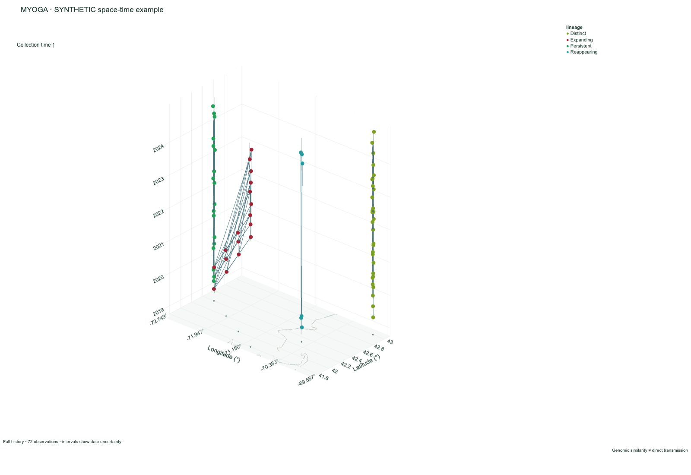

# myoga

**Map Your Own Genomics Atlas**

**myoga** is a local-first tool for geographically visualizing relatedness
trees from [mlvamaps](https://github.com/microbemarsh/mlvamaps) or
[Parsnp](https://github.com/marbl/parsnp) outbreak datasets.

It lets users explore phylogenomic trees, sample metadata, and geographic locations in a Microreact-like interface while keeping genomic and metadata files on their own machine.

---


---

## Why build myoga?

myoga is designed for local review of sensitive outbreak datasets.

During normal use:

- users select files from their own machine
- files are kept in local browser memory
- the app is served from `127.0.0.1`
- no myoga server receives genomic files or metadata
- release builds work without external setup

---

## Quick Start

The easiest way to use myoga is to download a release.

1. Go to the **Releases** page.
2. Download the ZIP file for your operating system.
3. Unzip it.
4. Run the myoga executable.

Platform examples:

- **Windows:** double-click `myoga.exe`
- **macOS/Linux:** double-click or run `./myoga`

myoga starts a local server on:

```text
127.0.0.1
```

Then it opens the app in your default browser.

No Python, Node.js, or command-line setup is required for release builds.

---

## Load an MLVAmaps export

Run `mlvamaps export-myoga`, then use the **mlvamaps export** picker in myoga
to select its output directory. No `.ggr` file is needed. myoga recognizes:

- `mlva_nj.tree` with `myoga_metadata.tsv`
- `combined_marker_nj.tree` with `combined_marker_metadata.tsv`

When both pairs are present, myoga loads the tree containing the most samples;
ties prefer the combined-marker tree. The status panel reports which pair was
selected. You can still use the individual **Tree** and **Metadata** pickers to
choose a different pair.

For example:

```bash
mlvamaps export-myoga \
  --results mlvamaps_output/ \
  --metadata metadata.tsv \
  --combined-markers \
  --loci loci.csv \
  -o myoga_export/
```

Then select `myoga_export/` in myoga.

## Load a Parsnp dataset

The existing Parsnp workflow remains supported. Load `parsnp.tree`, its
metadata table, and optionally `parsnp.ggr`. GGR is used only to cross-check
genome identifiers; it is not required to draw the tree or map.

The app keeps all selected files in browser memory and does **not** upload
genomic data, metadata, coordinates, or outbreak files anywhere.

---

## What myoga Shows

myoga provides an interactive local view of:

- genome/sample locations on a map
- an mlvamaps relatedness tree or Parsnp phylogenomic tree
- linked sample metadata
- optional local GeoJSON geography layers
- bundled offline map data

It is intended for confidential, case-by-case outbreak review where data should remain local.

---

## Example Data

To get a better look at what myoga can do, use the example data in the `example/mers49` folder.

The example opens in an offline globe view. Users can switch between globe and flat map modes, inspect tree structure, view metadata, and test the interface without providing their own files.

---

## Documentation

Longer documentation is available in the project wiki.

- Metadata file creation
- Supported metadata columns
- Custom GeoJSON layers
- Troubleshooting

---

## Notes

- The selected Newick tree is the authoritative source for sample labels.
- Tree distance clades are the default color mode when a tree is loaded. The
  clade-depth control cuts the tree by cumulative branch distance; higher values
  create more, smaller clades. Metadata columns remain available in the Color
  menu.
- mlvamaps exports do not require a `.ggr` file.
- For Parsnp data, `parsnp.ggr` is optional and is used only to cross-check
  genome names from the Parsnp/Gingr project file.
- myoga includes bundled map assets for offline-friendly use.
- Custom local GeoJSON layers can be loaded for outbreak-specific geography.
- Map zoom extends to 14x in globe mode and 48x in flat mode.

---

## Space-time genomic visualization

Collection time becomes a real third spatial dimension: longitude and latitude
locate each observation on the geographic plane, and time determines its height.
The entire sampled history can be inspected simultaneously, rotated, filtered,
or developed through playback. This is useful for pathogen surveillance,
environmental persistence, genomic epidemiology, wildlife disease, outbreak
investigation, longitudinal environmental sampling, and antimicrobial resistance
surveillance. Sampling effort and missing observations affect every apparent
pattern; this view does not estimate incidence, movement, ancestry, or transmission.



### Create a view

Choose **Space-time** in the existing app, select local files, and choose
**Generate portable HTML**. Processing stays in the local Go process. Open the
downloaded HTML directly in a browser; neither the myoga server nor an internet
connection is needed afterward. The browser form accepts up to 256 MiB of input;
use the CLI for larger matrices.

```bash
myoga space-time --metadata myoga_metadata.tsv
```

This writes `surveillance_4d.html`. Existing files are never overwritten; choose
another `--output` path when generating a new figure. From a source checkout,
build with `go build -o dist/myoga .`, or substitute `go run .` for `myoga`.

A complete, entirely **synthetic** example is included:

```bash
myoga space-time \
  --metadata example/space-time/metadata.tsv \
  --distances example/space-time/distances.tsv \
  --clusters example/space-time/clusters.tsv \
  --color-by lineage \
  --distance-label "synthetic dissimilarity units" \
  --output synthetic_space_time.html
```

The 72 invented observations span 2019–2024 at six sites, with local persistence,
an expanding distribution, reappearance, and a distinct lineage. These labels
describe the designed sampling pattern, not an inferred biological process.
The matrix is illustrative dissimilarity, not a calibrated genomic metric.
Regenerate the tables with `python3 example/space-time/generate.py`.

### Required metadata and uncertainty

CSV, TSV, and semicolon-delimited tables are accepted, including BOMs, quoted
fields, and embedded newlines. Required information is a sample ID, latitude,
longitude, and collection date. Standardized `sample_id`, `latitude`, `longitude`,
`collection_date_raw`, `collection_date_start`, `collection_date_end`,
`collection_date_precision`, and `collection_year` are recognized. Common
existing aliases such as `genome_id`, `lat`, `lon`, and `date` also work.
Combined `lat_lon` coordinates accept `10 N 20 W` or `10,-20`.

| Input date | Represented interval | Precision |
| --- | --- | --- |
| `2024-06-17` | June 17 only | Day |
| `2024-06` | June 1–30 | Month |
| `2024` | January 1–December 31 | Year |
| `2021-2023` | January 2021–December 2023 | Range |
| `2021-05/2023-06` | May 2021–June 2023 | Range |

`..` is also accepted as a range separator. Dates use the Gregorian calendar at
UTC day resolution; ambiguous locale formats and timestamps are rejected.
Standardized start/end bounds take precedence over raw text. Coarse declared
year/month precision expands to whole calendar years/months rather than inventing
a precise January 1 observation. Contradictory day precision and reversed or
incomplete bounds are invalid. A standardized `collection_date_valid=False`
excludes the observation unless an explicit `--time-column` override is used.

Each point sits at its interval midpoint **only as a display anchor**. Vertical
whiskers show the actual interval, and hover/details show bounds and precision.
The timeline selects observations whose intervals overlap the selected period;
it does not assign an exact appearance date to uncertain observations. Retained
history includes intervals beginning on or before the cursor; faded history
reduces opacity for observations whose intervals ended before the current window.

Missing IDs, missing or invalid coordinates, missing or malformed dates, and all
occurrences of duplicate sample IDs are excluded with a report. Zero coordinates
are valid. Numeric strings must parse in full; `NaN`, infinity, and out-of-range
coordinates are invalid. No country centroids are substituted. The CLI reports
counts; the HTML includes a downloadable report with IDs and logical record
numbers for individual exclusions. Structurally malformed tables and datasets
without any usable observations fail with a diagnostic. None of this changes
the existing map's treatment of samples without dates.

Available coordinate-uncertainty/precision fields remain in each observation's
metadata and in sample details. Spatial uncertainty volumes and terrain rendering
are deferred; schematic display offsets are not uncertainty estimates.

### Metagenomic communities from a Kraken2 report folder

Supply metadata plus a folder of **per-sample Kraken2 summary reports**:

```bash
myoga space-time \
  --metadata samples.tsv \
  --kraken-reports kraken_reports/ \
  --taxonomic-rank G \
  --abundance-threshold 1 \
  --output microbial_communities.html
```

The local app's Space-time form also has a **Kraken2 report folder** picker.
Use plain, uncompressed reports generated by Kraken2's `--report` option.
Both the standard six-column format and the eight-column
`--report-minimizer-data` format are supported. Per-read classification output,
MPA tables, and Bracken tables have different formats and are rejected by this
importer. The report format is described in the
[Kraken2 manual](https://github.com/DerrickWood/kraken2/wiki/Manual#sample-report-output-format).

For example, use this folder layout:

```text
samples.tsv
kraken_reports/
  S01.kreport
  S02.kraken2.report.txt
  S03.report.tsv
```

```tsv
sample_id	latitude	longitude	collection_date
S01	44.30	-76.10	2024-06-01
S02	44.30	-76.10	2025-06-01
S03	45.50	-73.50	2024-06-02
```

Recognized suffixes include `.kreport`, `.report`, `.report.txt`, `.report.tsv`,
`.kreport.txt`, `.kreport.tsv`, `.kraken2.report`, `.kraken2.report.txt`,
`.kraken2.report.tsv`, `_kraken2_report.txt`, `_kraken2_report.tsv`,
`_report.txt`, `_report.tsv`, `.kraken.report`, `.kraken2`, `.kraken`, `.txt`,
and `.tsv`. The filename stem is matched using the existing sample-ID rules.
The original full filename is tried first. A recognized suffix does not turn
per-read output into a summary report; the file contents are validated.

For irregular filenames, add a **`kraken_report`** column to metadata containing
the exact filename, such as `station_B_June.report.txt`. This mapping takes
precedence over automatic matching. Multiple reports matching one sample,
duplicate mappings, or ambiguous sample aliases are errors. Use a flat folder;
the CLI does not descend into subdirectories or follow symlinks. The browser
imports uploaded basenames, which must be unique. Files without a matched,
usable metadata row are ignored and reported. Samples without a report remain
as geographic/time context and are explicitly marked **missing report**, not
zero abundance.

Each colored point represents **one taxon in one sample** at the selected rank.
Rank defaults to genus (`G`); `D`, `K`, `P`, `C`, `O`, `F`, `G`, and `S`, or their
full names, are accepted. Only the exact selected rank is included, so `G1`
descendants and species rows are not mixed with genus counts. To change rank,
regenerate the HTML. All taxa at that rank are imported; host and environmental
eukaryote classifications are not automatically removed.

The percentage is computed from integer counts as:

```text
100 × taxon clade fragments / (classified root fragments + unclassified fragments)
```

This uses clade counts, not counts assigned directly to the taxon. The denominator
includes all fragments represented by the report, including unclassified ones;
it is not renormalized to the selected taxa or rank. The importer checks printed
percentages against this denominator allowing for report rounding, and rejects
invalid counts, duplicate taxids, inconsistent taxon names, missing totals,
zero-total reports, and impossible selected-rank totals. Complete all-unclassified
reports are valid and produce a sample anchor without taxon detections.

These are **Kraken classification proportions**, not Bracken abundance estimates,
cell counts, or absolute concentrations. Compare consistently processed samples
using the same database, filtering, and classification settings. Standard report
columns do not identify the database/version or prove that reports are complete.
In particular, `kraken2-inspect` database summaries have the same layout and must
not be supplied as sample reports. The importer does not run a classifier.

The initial threshold defaults to **1%** and is adjustable from 0–100% using the
slider or an exact numeric input. Equality is included. Positive taxa below the
threshold remain in the HTML and sample details; reported zero-count taxa remain
in the profile but never appear as detections. Omitted taxa are not imputed as
zero. Colors identify taxa by name and taxid; optional point areas encode
proportion on a fixed scale across samples and dates. Metadata coloring and
filters, playback, date intervals, PNG/SVG exports, and saved settings also work.

Gray diamond anchors mark each sample's true coordinates and temporal midpoint.
Colored taxa use schematic offsets to reduce overlap; turn offsets off to use
exact coordinates. Click an anchor or use the sample selector to inspect the
report's counts, unclassified fraction, and **all reported taxa at the selected
rank**, including zero-count and below-threshold entries. Missing reports and
all-unclassified samples remain inspectable even when no taxa are visible.
Rendering cost depends on the number of sample–taxon observations, not just the
number of samples; very dense sites may still overlap. Isolate a taxon through
the legend for closer inspection.

`--kraken-reports` cannot be combined with `--distances`: the genomic-neighbor
edge mode does not describe community composition. This import does not infer
environmental associations, compute community distances, or establish absolute
abundance changes.

A small **entirely synthetic** example contains four reports, including one
with minimizer columns and one all-unclassified sample, plus a sample with no
report. Its taxon names/IDs and counts are illustrative, not biological findings:

```bash
myoga space-time \
  --metadata example/metagenomics/metadata.tsv \
  --kraken-reports example/metagenomics/reports \
  --taxonomic-rank genus \
  --abundance-threshold 1 \
  --output metagenomic_example.html
```

### Optional genomic information

A distance matrix must be a square, labeled CSV/TSV table with the sample IDs in
the first row and first column. The top-left cell may be blank. Rows can be in
any order. Distances must be finite, nonnegative, numerically symmetric, with
zero diagonal. Missing entries, duplicate IDs, and asymmetric matrices are
errors. Similarity scores such as ANI require an explicitly chosen conversion
to dissimilarity upstream; myoga never guesses a conversion or rescales units.
SNP, allele, Mash, and other dissimilarity matrices are not tied to a pipeline.

Matching first uses exact, case-sensitive IDs. If that fails, basename and
FASTA/GenBank suffix removal are allowed, including compressed filenames.
Ambiguous aliases and multiple matrix IDs matching one observation are rejected.
Case, accession versions, and hyphens/underscores are deliberately preserved to
avoid merging distinct observations. Both directions of unmatched IDs are
reported relative to the observations usable in space-time.

The matrix reader keeps at most **8 nearest candidates per sample** by default.
It deduplicates undirected pairs, sorts by distance (with deterministic ties),
and greedily accepts edges subject to a maximum degree of 8 and a total cap of
20,000. This is a **sparse genomic-neighbor graph**, not all pairs below a
threshold, and it need not be connected. Raising the browser threshold only
reveals retained edges. Regenerate with larger caps when needed. Edges touching
hidden samples disappear, and optional opacity encodes relative input distance.

> Genomic-neighbor connections represent genomic similarity between observations
> and should not be interpreted as direct transmission events.

Clusters can be supplied in metadata or a separate table containing `sample_id`
and `cluster`. Conflicting assignments fail rather than silently replacing
metadata. Myoga does not perform distance clustering or infer clades in this
mode. Click a cluster/category in the legend to isolate it, or combine filters.

**Phylogenetic geometry is explicitly deferred.** `--tree` produces a diagnostic
and the corresponding connection choice is disabled. Internal ancestral nodes
have no observed coordinates or collection dates. Drawing arbitrary adjacent
Newick tips would be misleading. The existing map/tree viewer still accepts
Newick; externally derived clade labels can be used as metadata colors here.

### Controls and figures

- Drag to rotate; use Plotly's toolbar for pan/zoom. Oblique, top-down, and
  temporal camera presets give reproducible starting views.
- Automatic/year/month/day labels all use **linear elapsed time**. These choices
  control ticks, not binning or rounding observation dates. Time-axis height
  expands or compresses the temporal dimension independently of geographic scale.
- The offline Natural Earth country/coastline boundaries and sampled sites lie
  on the base plane. No tile provider is contacted. Equirectangular geographic
  coordinates use an aspect ratio corrected at the dataset's central latitude.
  The longitude seam is placed in the largest unsampled gap to handle dateline
  crossings. This is not a geodesic-distance measurement tool; broad or polar
  extents are distorted, and the bundled 1:50m basemap is coarse for local studies.
- Nearly identical sites (coordinates rounded to six decimal places) receive
  small deterministic radial display offsets. These scale with the viewing
  extent, not meters, and preserve true coordinates in hover/details. Turn
  offsets off for exact spatial placement. Dense sites can still occlude points;
  the searchable sample selector provides access to every observation.
- Full history and play/pause/reset support current-window, retained-history,
  and faded-history modes, with adjustable speed and window size in days.
  At 1×, playback targets approximately 30 seconds for the complete time range.
- All metadata columns can color points. Category colors are deterministic;
  large category sets can have similar or repeated hues. Search the legend to
  find categories beyond the first 100. The figure legend shows at most 20 and
  discloses additional categories. Choose a lower-cardinality variable for figures.
- Reasonable categorical columns (2–100 values) are suggested for combined
  filters. Choose an additional hover field or inspect all metadata on selection.
- **Export PNG** and **Export SVG** retain the geographic/time axes and figure
  legend, with configurable dimensions and white/transparent backgrounds.
  Controls are omitted. The WebGL scene in SVG is an embedded raster, not a
  vector reconstruction. Exports are limited to 400–6000 pixels per dimension;
  maximum workable sizes depend on browser/GPU resources. Hide controls for a
  full-window view and restore them with **Show controls**.
- **Export settings / Load settings** preserves the camera, time controls,
  colors, filters, selected category, edge threshold, uncertainty/offset toggles,
  and export dimensions. Files are validated and bound to a SHA-256 fingerprint
  of the dataset and retained graph. Save the HTML and settings together.

The HTML contains all included metadata and the retained graph, including samples
currently hidden by filters. It is not an anonymized subset or a static screenshot.

### CLI options

| Option | Default / behavior |
| --- | --- |
| `--metadata` | Required metadata path |
| `--output` | `surveillance_4d.html`; must not already exist |
| `--distances` | Optional labeled symmetric distance matrix |
| `--clusters` | Optional sample ID / cluster assignments |
| `--kraken-reports` | Optional flat folder of Kraken2 sample summary reports |
| `--taxonomic-rank` | `G` (genus); one exact rank per community view |
| `--abundance-threshold` | Initial Kraken clade percentage, default 1; adjustable 0–100 |
| `--color-by` | `kraken_taxon` for community reports; otherwise a recognized cluster/lineage/species/host/country column, then the first column |
| `--id-column`, `--lat-column`, `--lon-column` | Exact column overrides |
| `--time-column` | Date override; ignores standardized bounds/precision |
| `--distance-label` | `genomic distance (input units)` |
| `--max-edges-per-sample` | 8; allowed 1–100 |
| `--max-edges` | 20,000; allowed 1–200,000 |
| `--tree` | Reserved; fails explicitly because geometry is deferred |

### Architecture, performance, and testing

The original application is a Go 1.22+ executable embedding vanilla JavaScript,
SVG maps/trees, examples, and offline GeoJSON through `embed.FS`. It has no Python
package, Node build pipeline, or existing report generator. The original browser
stores collection dates as strings and normalizes metadata locally. This feature
retains that viewer and its workflows. The Go CLI/form share one strict
space-time parser following the existing metadata aliases and missing-value
conventions; Go's standard `encoding/csv` handles table quoting. Observations,
bounded genomic relationships, and browser settings are separate structures.

The new view bundles **Plotly.js gl3d 2.35.2** with its licenses. Plotly's
[3D scatter renderer](https://plotly.com/javascript/3d-scatter-plots/) and
[image exports](https://plotly.com/javascript/static-image-export/) provide
scientific axes, picking, cameras, and publication captures without custom
graphics infrastructure. We evaluated deck.gl's
[OrbitView](https://deck.gl/docs/api-reference/core/orbit-view); it remains a
reasonable future option if profiling justifies a more specialized renderer.
Three.js would require more custom axes/export work, while a MapLibre/Cesium
stack adds map infrastructure this initial planar view does not need. The pinned
bundle adds about 1.7 MB and has no runtime CDN dependency. Its SHA-256 is
`79694da69e3ae5ef0dcaba96fd5b8fe00b03849388a658a4d2d4d7e978fd8757`.

Observations and whiskers use batched WebGL traces; edge opacity uses four batches
rather than one object per edge. Rendering uses O(N + E) data. A dense matrix
necessarily takes O(M²) time and temporary disk space (8M² bytes for numeric
values), but nearest-candidate memory is O(Nk), symmetry validation uses 128-row
blocks, and the output never contains all M² distances. Ensure temporary storage
is sufficient; a 10,000 × 10,000 matrix needs about 800 MB of temporary numeric
storage in addition to its source file. Temporary data is removed after processing.

Measurements on an Apple M5 Pro, Go 1.23.12, with headless Chrome using software
WebGL (SwiftShader), not a dedicated graphics benchmark:

| Check | 1,000 observations | 10,000 observations |
| --- | ---: | ---: |
| Go metadata ingestion, one iteration | 17 ms | 86 ms |
| Standalone HTML size | 5.0 MB | 7.1 MB |
| Browser initial load | 1.84 s | 2.19 s |
| Metadata recoloring | 102 ms | 133 ms |
| Camera relayout call | 2 ms | 3 ms |

The camera numbers measure completion of the relayout call, **not frame rate**.
The browser benchmarks omit genomic edges; the synthetic regression covers
edges separately. A 1,000 × 1,000 matrix validated and selected neighbors in
74 ms, with about 30 MB total allocated during that run. These are single-run
measurements, not guarantees. Large uncertainty sets, edge caps, metadata width,
and GPU/browser differences affect interaction. Desktop/laptop is the priority.
The responsive layout was checked at 390 px. Chrome was tested; native Safari,
Firefox, and Edge remain compatibility targets rather than verified releases.

Run the complete Go suite and the dependency-free JavaScript checks:

```bash
go test ./...
go test -race ./...
go vet ./...
node scripts/space-time-check.cjs
go test -run '^$' -bench Space -benchtime=1x -benchmem
```

Tests cover date precision and bounds, coordinates, duplicate IDs, CSV quoting,
matrix validation/matching, edge limits/thresholds, deterministic colors,
dateline placement, interval-overlap filtering, settings validation, safe HTML
embedding, CLI invocation, and local browser form generation. Existing tests
remain intact. An optional Playwright check tests actual browser controls,
combined filters, sample selection, offline behavior, settings round trips,
PNG/SVG exports, mobile layout, and 1,000/10,000-sample rendering:

Community tests also exercise standard/minimizer reports, clade vs. direct
counts, denominator validation, matching and duplicates, missing/zero reports,
rank selection, threshold changes, below-threshold inspection, and community
settings round trips.

```bash
# Install Playwright in a temporary directory, not as a runtime dependency.
npm install --prefix /tmp/myoga-browser-check playwright@1.51.1
go build -o dist/myoga .
NODE_PATH=/tmp/myoga-browser-check/node_modules \
MYOGA_BROWSER="/path/to/installed/chrome" \
node scripts/space-time-browser-check.cjs dist/myoga /tmp/myoga-browser-results
```

Use a fresh result directory. The script leaves exported figures, settings, and
benchmark JSON for inspection. No analytics such as inferred transmission,
ancestral geography, diffusion, or clustering are implemented.

---

## Author

Austin G. Marshall
